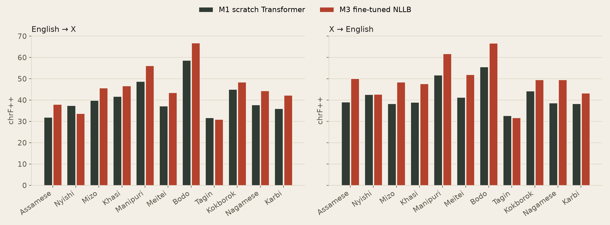
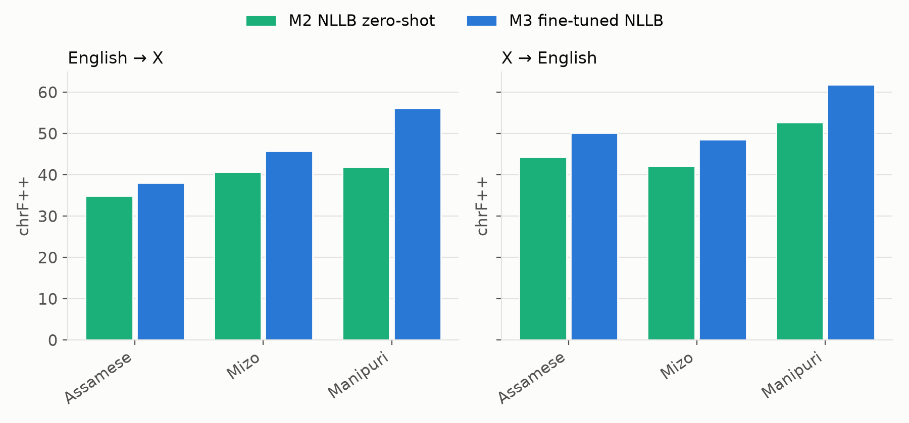
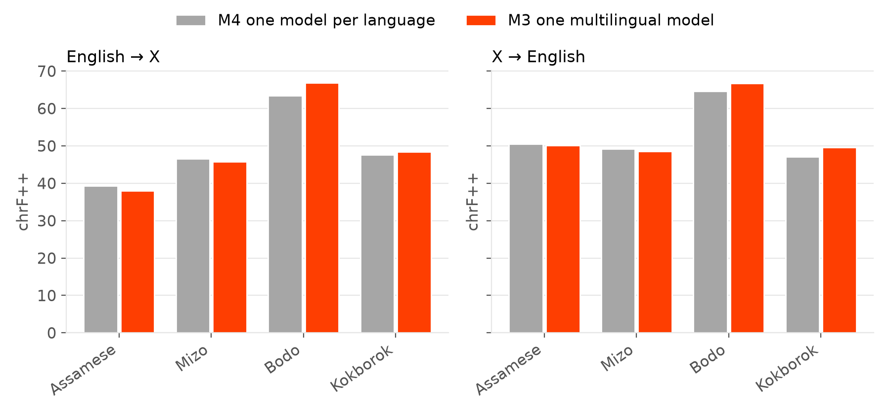
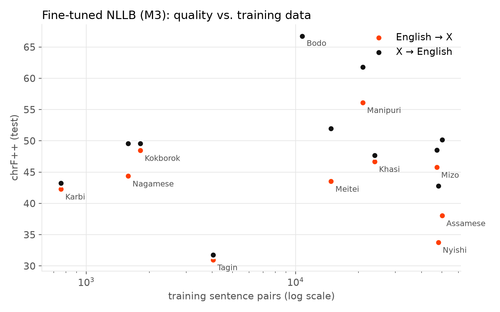

# Exp 10 — Low-Resource Neural Machine Translation (WMT26 Indic MT)

English ⇔ 11 low-resource Indic / North-East Indian languages, trained on the **WMT26 Indic MT shared-task 2026 training data**.
We compare a Transformer trained from scratch, zero-shot NLLB-200, and NLLB-200 fine-tuned on all 11 languages
(and per language), and evaluate with chrF++, spBLEU, TER and COMET plus bootstrap significance tests.

Planning document with every design decision and the alternatives considered: [STRATEGY.md](STRATEGY.md).

**Trained models on Hugging Face:** [M3 (main model)](https://huggingface.co/AI-Coder-27/nlp-exp10-m3-nllb600m-11indic) ·
[all checkpoints](#trained-models).

## Research questions

| RQ | Question | Compared |
|---|---|---|
| RQ1 | Does a pretrained model beat training from scratch? | M1 vs M3 |
| RQ2 | Does fine-tuning help even for languages the pretrained model already knows? | M2 vs M3 |
| RQ3 | Does one multilingual model help the smaller languages, compared with one model per language? | M3 vs M4 |
| RQ4 | How do data size, domain and script affect quality? | analysis of M3 |

## 1. Dataset

Source: [WMT26 Indic MT task](https://www2.statmt.org/wmt26/indic-mt-task.html), 2026 training data (Category I and II).
The official 2026 test set is password-protected for registered participants and its references were never published,
so we hold out our own dev/test split (§2). Please cite the WMT23–25 Indic MT Findings papers when using this data.
The data itself is **not** committed to this repository.

| Lang | Code | Script | Cat. | Raw rows | Clean pairs | Train / Dev / Test | Main domain |
|---|---|---|---|---|---|---|---|
| Assamese | as | Bengali | I | 54,000 | 52,120 | 50,083 / 880 / 881 | mixed (Bible, agriculture, news) |
| Nyishi | njz | Latin | I | 60,000 | 50,091 | 48,089 / 1,001 / 999 | short everyday sentences + dictionary |
| Mizo | lus | Latin | I | 50,000 | 49,339 | 47,297 / 1,000 / 997 | Bible, stories, chat |
| Khasi | kha | Latin | I | 26,000 | 25,870 | 23,865 / 1,000 / 1,000 | Bible |
| Manipuri | mni | Bengali | I | 23,687 | 22,942 | 20,924 / 990 / 991 | government press releases |
| Meitei | mtei | Meitei Mayek | I | 17,000 | 16,801 | 14,774 / 1,000 / 1,000 | news, health |
| Bodo | brx | Devanagari | II | 15,215 | 12,766 | 10,766 / 1,000 / 1,000 | history, sports, news |
| Tagin | tgj | Latin | II | 5,343 | 5,187 | 4,032 / 520 / 519 | short phrases, culture |
| Kokborok | trp | Latin | II | 2,269 | 2,265 | 1,813 / 226 / 226 | Bible |
| Nagamese | nag | Latin | II | 7,205 | 1,983 | 1,585 / 198 / 198 | history, sports, news |
| Karbi | mjw | Latin | II | 1,000 | 959 | 757 / 96 / 96 | news headlines |

Rows removed at each cleaning step are in [results/data_stats.csv](results/data_stats.csv).

## 2. Preprocessing — `src/prepare_data.py`

1. **Per-file loading rules.** Every file has a different layout: Mizo and Nagamese have no header, Tagin has its columns
   swapped, Bodo and Nagamese contain domain-tag rows ("500 from History"), and Nagamese has 5.2k blank rows.
2. **Normalization.** Unicode NFC, non-breaking/zero-width spaces → space, repeated spaces collapsed, and the
   pre-tokenized spacing used by half the files (`word ,`) undone so all files share one style.
3. **Filtering.** Empty pairs, exact duplicate pairs (Nyishi had ~9.9k, Bodo repeats a 2.4k-row block), source = target,
   more than 100 words, length ratio above 3 (when the longer side has more than 5 words), and wrong-script text
   (e.g. Bengali inside Nagamese, Kannada inside Meitei).
4. **Dictionary entries** (≤ 3 English words): kept for training, never put in dev/test.
5. **Leakage-safe split.** The same English sentence occurs in several languages' files (Assamese–Khasi share 7.4k Bible
   verses). The split is therefore **grouped by English sentence across all 11 languages**: an English sentence is in
   train, dev or test for every language at once. Dev = test = min(1000, 10%) per language. The script asserts no English
   sentence appears in two splits. Later checks found 0% exact English overlap and 0–2% target-side overlap
   (short common phrases) between train and test.

### Meitei Mayek script — `src/meitei.py`
NLLB's tokenizer has no Meitei Mayek characters: **48.7% of Meitei subword tokens are UNK** (every other language is ≤ 2.5%,
see [results/tokenizer_stats.csv](results/tokenizer_stats.csv)). NLLB does know Manipuri in Bengali script, so Meitei
text is transliterated to Bengali script for the model and converted back before scoring. The only ambiguity
(final consonant vs. conjunct) is resolved with a rule fitted on the data; **96.6% of sentences round-trip exactly**,
which is the ceiling on Meitei scores.

## 3. Models — `src/train.py`

| ID | Model | Data | Notes |
|---|---|---|---|
| **M1** | Transformer from scratch, 61M params (6+6 layers, d=512), own SentencePiece 32k vocab | all 11 languages, both directions | dropout 0.3, label smoothing 0.1, lr 5e-4 inverse-sqrt |
| **M2** | NLLB-200-distilled-600M, zero-shot | as, lus, mni only (the languages NLLB knows) | no training |
| **M3** | NLLB-200-distilled-600M fine-tuned | all 11 languages, both directions | Adafactor lr 1e-4, bf16, effective batch 64 |
| **M4** | NLLB-200-distilled-600M fine-tuned on one language | as, lus (Cat. I), brx, trp (Cat. II), 4 separate models | same settings as M3; max epochs as 2, lus 2, brx 4, trp 15 so each model sees its language at least as often as M3 did (M3: 1.1 / 1.1 / 3.7 / 15 passes); early stopping on dev |

Shared choices:
- **Both directions in one model**, with the target-language code as the first decoder token (NLLB format).
- **8 new language codes** added to NLLB (e.g. `kha_Latn`, `brx_Deva`), each initialized from a related existing code
  (Latin-script languages from `lus_Latn`, Bodo from `hin_Deva`, Meitei from `mni_Beng`).
- **Temperature sampling (T = 5)** to balance the 66× data imbalance, resampled every epoch. Karbi is upsampled ~15×.
- **Checkpoint selection on dev only**: mean dev chrF++ over all directions (greedy decoding, 100 sentences per direction),
  evaluated every 2,000 steps (M3) / every epoch (M1), with early stopping.
- **Decoding**: beam 4 and `no_repeat_ngram_size = 4`. The n-gram setting was chosen on the **dev set** from {off, 3, 4}
  (best for all three models) after M3 was found to loop on a few long Tagin sentences. Results without it are kept in
  `results/metrics_nr0.csv`.

**Training was interrupted** by a reboot of both GPU servers. We report the best dev-selected checkpoints:
M3 after **2 of 3 planned epochs** (dev chrF++ still rising slowly, +0.7 per half epoch) and M1 after **17 epochs**
(dev chrF++ flat). Training curves are in each checkpoint's `trainer_state.json`.

## 4. Evaluation — `src/evaluate.py`

| Metric | Directions | Why |
|---|---|---|
| **chrF++** (primary) | all 22 | character-level, robust for agglutinative languages and small test sets |
| **spBLEU** (FLORES-200 SentencePiece) | all 22 | BLEU as used for NLLB; plain BLEU tokenizes Indic scripts badly. Meitei scored in Bengali script |
| **TER** | all 22 | listed by the WMT26 task |
| **COMET** (wmt22-comet-da) | into English only | COMET's XLM-R encoder never saw most of these languages, so scores into them would be meaningless |

Every comparison uses **paired bootstrap resampling** (1,000 samples, same resamples for both systems). A system "wins"
a direction only when the 95% confidence interval of the chrF++ difference is entirely above zero.

## 5. Results (test set)

chrF++, shown as **English→X / X→English**. Full tables (spBLEU, TER, COMET, confidence intervals): [results/summary.md](results/summary.md).

| Language (train pairs) | M1 scratch | M2 zero-shot | M3 fine-tuned | M3 COMET (→en) |
|---|---|---|---|---|
| Assamese (50k) | 32.0 / 39.2 | 34.8 / 44.3 | **38.0 / 50.2** | 79.5 |
| Nyishi (48k) | **37.5** / 42.7 | – | 33.8 / 42.8 | 73.4 |
| Mizo (47k) | 39.9 / 38.4 | 40.7 / 42.1 | **45.8 / 48.5** | 68.7 |
| Khasi (24k) | 41.7 / 39.0 | – | **46.7 / 47.7** | 66.2 |
| Manipuri (21k) | 48.8 / 51.8 | 41.9 / 52.7 | **56.1 / 61.8** | 80.8 |
| Meitei (15k) | 37.3 / 41.3 | – | **43.5 / 52.0** | 73.1 |
| Bodo (11k) | 58.7 / 55.6 | – | **66.9 / 66.8** | 82.0 |
| Tagin (4k) | 31.8 / 32.7 | – | 31.0 / 31.8 | 63.5 |
| Kokborok (1.8k) | 45.1 / 44.3 | – | **48.5 / 49.6** | 66.7 |
| Nagamese (1.6k) | 37.8 / 38.7 | – | **44.4 / 49.6** | 75.7 |
| Karbi (0.8k) | 36.1 / 38.3 | – | **42.3 / 43.3** | 68.5 |
| **Mean (all directions)** | 41.3 | 42.7 (6 dirs) | **47.3** | |

Bold = significantly better than the other systems in that row (95% bootstrap CI).

**Significance:** M3 beats M1 in **18 / 22** directions (3 ties: Tagin both ways, Nyishi→English; 1 loss: Nyishi
English→Nyishi). M3 beats M2 in **6 / 6** directions.

### One multilingual model (M3) vs one model per language (M4)

| Language (train pairs) | M4 per-language | M3 multilingual | Δ (M3 − M4), 95% CI | Winner |
|---|---|---|---|---|
| Assamese (50k) | 39.3 / 50.5 | 38.0 / 50.2 | −1.2 [−1.7, −0.8] / −0.3 [−0.8, 0.2] | **M4** / tie |
| Mizo (47k) | 46.6 / 49.2 | 45.8 / 48.5 | −0.8 [−1.2, −0.4] / −0.7 [−1.2, −0.1] | **M4** / **M4** |
| Bodo (11k) | 63.4 / 64.6 | 66.9 / 66.8 | +3.4 [2.9, 4.0] / +2.2 [1.5, 2.8] | **M3** / **M3** |
| Kokborok (1.8k) | 47.6 / 47.2 | 48.5 / 49.6 | +0.9 [0.1, 1.7] / +2.4 [1.3, 3.4] | **M3** / **M3** |

chrF++, English→X / X→English. COMET into English agrees (Bodo 82.0 vs 80.6, Kokborok 66.7 vs 64.9; Assamese and Mizo within 0.5).






### Findings
1. **RQ1 — pretraining helps.** Fine-tuned NLLB beats the scratch model by +6 chrF++ on average, most on X→English
   (e.g. Nagamese +10.9, Bodo +11.2, Meitei +10.6), where generating English benefits from NLLB's pretraining.
2. **RQ2 — fine-tuning helps even known languages.** Manipuri English→X improves from 41.9 (zero-shot) to 56.1.
3. **RQ3 — sharing helps the small languages and costs the large ones a little.** The multilingual model is
   significantly better for both Category II languages (Bodo +2.2 to +3.4, Kokborok +0.9 to +2.4), which borrow
   from the other 10 languages. For the two largest languages a dedicated model is slightly better (−0.3 to −1.2):
   with 47–50k pairs they have enough data of their own, and in M3 they share capacity and are downsampled by
   temperature sampling. This is the well-known multilingual transfer vs. interference trade-off.
4. **RQ4 — data size is not the main driver.** Bodo (11k pairs) scores highest; Nyishi (48k) is among the lowest.
   Domain and data style matter more: Nyishi and Tagin are dominated by very short sentences and dictionary entries.
5. **Where M3 loses.** On Nyishi English→X the scratch model wins (−3.7). M3 saw Nyishi for about 2 epochs (downsampled
   by temperature sampling); M1 saw it ~8× more often over 17 epochs. Finishing M3's 3rd epoch is the obvious next step.
6. **Decoding matters for under-trained languages.** Without repetition blocking M3 looped on 4.4% of Tagin test
   sentences (TER 109); the dev-chosen `no_repeat_ngram_size=4` fixed it (Tagin English→X 27.5 → 31.0).
7. Scores are **not comparable across languages**: domains differ (Bible vs news) and chrF++ behaves differently across
   scripts. Compare models within a row, not languages within a column.

### Trained models

All checkpoints are on the Hugging Face Hub, each with a model card listing its test scores and usage
(CC-BY-NC-4.0, following the NLLB-200 base model). M2 is the unmodified
[facebook/nllb-200-distilled-600M](https://huggingface.co/facebook/nllb-200-distilled-600M).

| Model | Hugging Face repo |
|---|---|
| M1 — Transformer from scratch, 11 languages | [AI-Coder-27/nlp-exp10-m1-scratch-transformer-11indic](https://huggingface.co/AI-Coder-27/nlp-exp10-m1-scratch-transformer-11indic) |
| M3 — NLLB-600M fine-tuned, 11 languages | [AI-Coder-27/nlp-exp10-m3-nllb600m-11indic](https://huggingface.co/AI-Coder-27/nlp-exp10-m3-nllb600m-11indic) |
| M4 — NLLB-600M, Assamese only | [AI-Coder-27/nlp-exp10-m4-nllb600m-as](https://huggingface.co/AI-Coder-27/nlp-exp10-m4-nllb600m-as) |
| M4 — NLLB-600M, Mizo only | [AI-Coder-27/nlp-exp10-m4-nllb600m-lus](https://huggingface.co/AI-Coder-27/nlp-exp10-m4-nllb600m-lus) |
| M4 — NLLB-600M, Bodo only | [AI-Coder-27/nlp-exp10-m4-nllb600m-brx](https://huggingface.co/AI-Coder-27/nlp-exp10-m4-nllb600m-brx) |
| M4 — NLLB-600M, Kokborok only | [AI-Coder-27/nlp-exp10-m4-nllb600m-trp](https://huggingface.co/AI-Coder-27/nlp-exp10-m4-nllb600m-trp) |

To translate with a downloaded model: `python src/translate.py --model_dir <repo id or local folder> --name out --langs as --split test --no_repeat 4`
(the NLLB models load straight from the Hub id; for M1 download the folder first, it uses its own `spm.model`).

## 6. How to run

Requires one NVIDIA GPU (≥ 12 GB; developed on RTX 4090 / 4070) and Python 3.12.

```bash
pip install -r requirements.txt
# put the WMT26 "Category I" and "Category II" folders in this directory, then:
python src/prepare_data.py            # data/{train,dev,test}.jsonl + results/data_stats.csv
python src/tokenizer_check.py         # results/tokenizer_stats.csv
python src/meitei.py                  # transliteration round-trip check
cd src
python train.py --model scratch --bsz 64 --accum 2 --epochs 30 --eval_steps 3500 --patience 4 --out ../checkpoints/m1_scratch
python train.py --model nllb --out ../checkpoints/m3_nllb_multi
python train.py --model nllb --langs brx --epochs 4 --eval_steps 150 --out ../checkpoints/m4_nllb_brx   # M4, per language
python translate.py --model_dir ../checkpoints/m3_nllb_multi/best --name m3 --no_repeat 4
python translate.py --model_dir ../checkpoints/m1_scratch/best --name m1 --no_repeat 4
python translate.py --model_dir facebook/nllb-200-distilled-600M --name m2 --no_repeat 4 --langs as lus mni
python evaluate.py --systems m1 m2 m3 m4 --compare m3:m1 m3:m2 m3:m4 --comet
python analyze.py                     # results/figures/*.png + results/summary.md
```

## 7. Limitations and future work
- M3 stopped at 2 of 3 epochs and M1 at 17 epochs (server reboot); M3 is still improving on the smaller languages.
- Our test set is a held-out part of the training data, not the official WMT26 test set, so scores are not directly
  comparable with shared-task results.
- Karbi (96) and Nagamese (198) test sets are small; see the confidence intervals.
- Future work: IndicTrans2 for Assamese/Bodo/Manipuri/Meitei, back-translation with monolingual data, larger NLLB models,
  LLM few-shot prompting as a comparison, and human evaluation by native speakers.

## Repository layout
```
src/prepare_data.py   cleaning, filtering, grouped split
src/meitei.py         Meitei Mayek <-> Bengali transliteration
src/tokenizer_check.py  NLLB UNK rate and fertility per language
src/common.py         language codes, tokenizers, batched translation
src/train.py          M1 / M3 / M4 training
src/translate.py      test-set translation
src/evaluate.py       chrF++, spBLEU, TER, COMET, bootstrap significance
src/analyze.py        charts and markdown tables
results/              metrics, significance, predictions, figures
```
